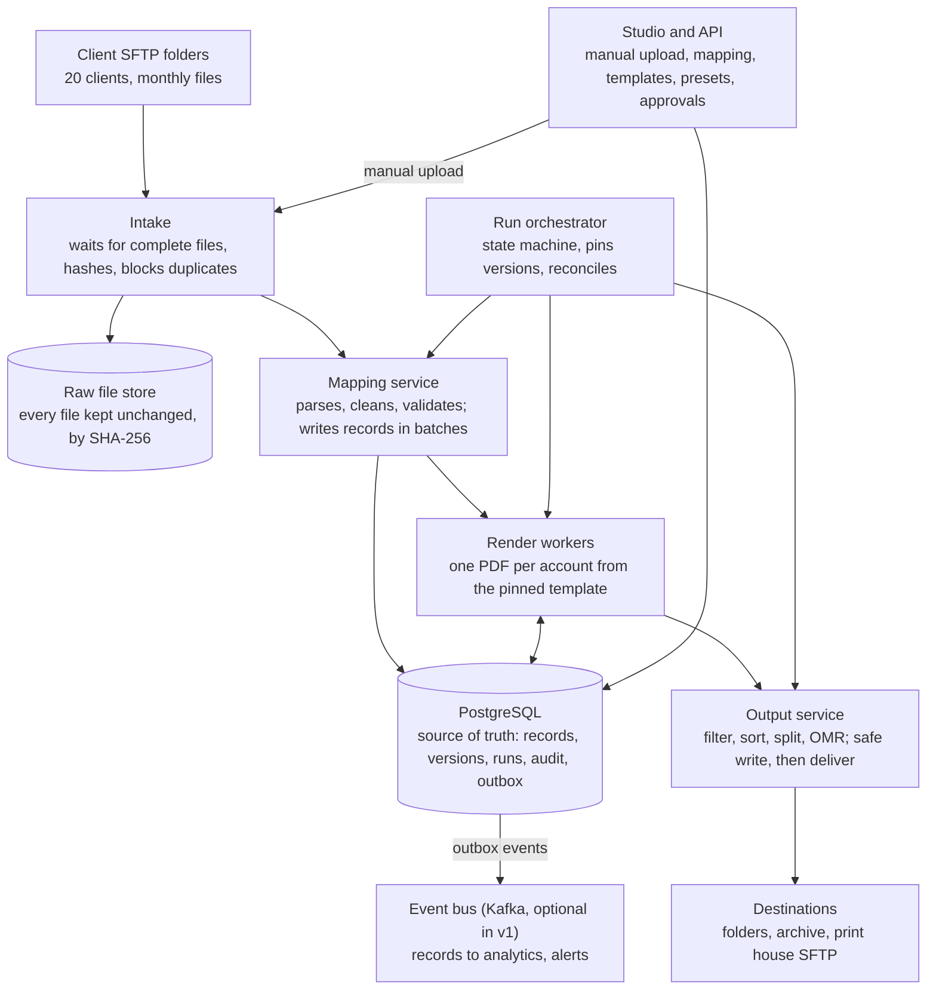
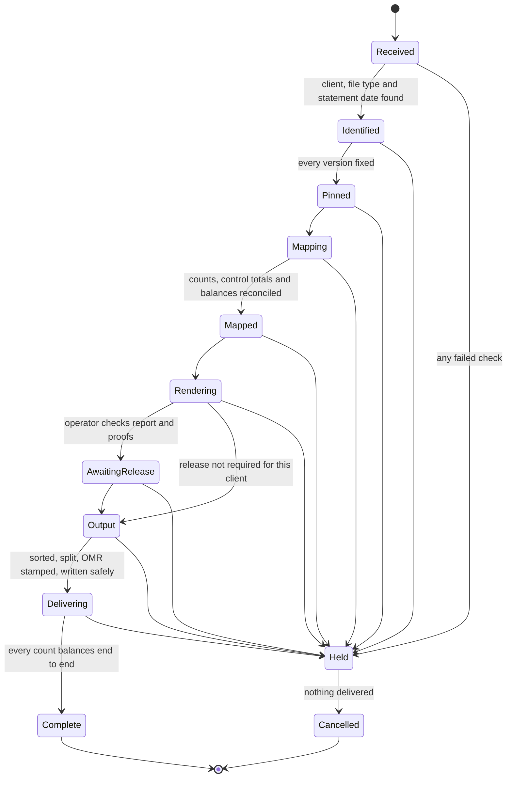

# StateMint: Architecture

Nov 4, 2026 · @Lucid Technologies

## Purpose and scope

StateMint turns client data files into finished statements, records and analysis inputs, with mapping, layout and output controlled by business users through an internal web app instead of code.

In scope: file intake (SFTP and manual upload), mapping of delimited, fixed-width, XML and JSON files, statement templates, PDF rendering with multi-page handling and OMR, output sorting, splitting and delivery, approvals, versioning and audit. Out of scope for version 1: email sending, a customer-facing portal, and print-stream formats (AFP, PostScript) unless a print house requires them.

### Decisions taken

| Area | Decision |
| --- | --- |
| Core language | Java 25 LTS, Spring Boot 4.1 |
| Front end | React + TypeScript; GrapesJS for layout, embedded rich-text editor for text blocks |
| Pipeline | Apache Kafka for events and records; Apache NiFi for file pickup (see open decisions) |
| Rendering | HTML/CSS paged-media templates to PDF with the maintained OpenHTMLtoPDF fork; headless Chromium as fallback |
| PDF post-processing | Apache PDFBox 3 for merging, splitting, OMR and PDF/A |
| Barcodes and QR codes | Okapi Barcode to draw codes; ZXing only to read them back for checking |
| Metadata store | PostgreSQL |
| File storage for HA | SeaweedFS or Garage (S3-compatible), not MinIO |
| Sign-in | The app's own accounts, with multi-factor authentication |
| Availability | Single node now; every component designed so it can scale out later |
| Platforms | Ubuntu 26.04 LTS servers for production; Windows and macOS for development and small installs |
| Documents | Drafted here, then committed as Markdown to the GitHub repo |

### Versions and support

Every version below was checked in November 2026 and has support well past the pilot; two earlier choices were replaced because they are no longer actively maintained.

| Component | Version to use | Supported until | Notes |
| --- | --- | --- | --- |
| Java (Eclipse Temurin) | 25 LTS | At least September 2031 | Replaces Java 21, whose Temurin support runs to at least December 2029. The next LTS is expected in September 2027. |
| Spring Boot | 4.1 | About July 2027 (open-source support) | Supports Java 17 to 26. Each minor line gets about 13 months of free support, so plan a yearly upgrade. |
| PostgreSQL | 18 | November 2030 | 19 is due or newly out; move to it after its second patch release. |
| Apache Kafka | 4.4 | Current line | KRaft only; no ZooKeeper. |
| Apache NiFi | 2.12 | Only until the next release | Only the newest NiFi release is supported, so NiFi needs frequent upgrades. This strengthens the case for a plain Java intake service in version 1. |
| OpenHTMLtoPDF | 1.1.37 or later, `io.github.openhtmltopdf` | Community maintained | The original `com.openhtmltopdf` project is no longer maintained; the maintained fork continues it. |
| Apache PDFBox | 3.0.8 or later | Current line |  |
| Okapi Barcode | 0.5.x | Actively maintained, Apache 2.0 | Replaces ZXing for drawing, because ZXing is in maintenance mode with no active development. |
| ZXing | 3.5.x | Maintenance mode | Used only to decode codes in the read-back check, where its stability is enough. |
| GrapesJS | 0.23.x | Active, releases about every 3 weeks |  |
| React | 19.3 | Active |  |
| TypeScript | 7.0 | Active | Its tooling API arrives in 7.1, so keep the `@typescript/typescript6` package for linting until then. |
| Apicurio Registry | 3.x | Active, Apache 2.0 | Only needed if Kafka stays in version 1. |
| Ubuntu Server | 26.04 LTS | April 2031 (standard), longer with Ubuntu Pro |  |
| Object storage for HA | SeaweedFS (Apache 2.0) or Garage | Active | MinIO's community edition stopped publishing binaries in October 2025 and its repository was archived in 2026, so it is no longer a safe choice. |

Sources: [Temurin support](https://adoptium.net/support), [Spring Boot versions](https://www.herodevs.com/blog-posts/spring-boot-versions-eol-dates-and-latest-releases-april-2026), [PostgreSQL versions](https://versionlog.com/postgresql/), [Kafka releases](https://kafka.apache.org/blog/2026/09/29/apache-kafka-4.2.2-release-announcement/), [NiFi support](https://endoflife.date/apache-nifi), [OpenHTMLtoPDF status](https://www.github.com/danfickle/openhtmltopdf/issues/969), [OpenHTMLtoPDF fork](https://badges.mvnrepository.com/artifact/io.github.openhtmltopdf/openhtmltopdf-objects/1.1.37/changes), [PDFBox 3.0.8](https://release-catalog.apache.org/pdfbox/3.0.8/index.html), [ZXing status](https://github.com/zxing/zxing/), [Okapi Barcode](https://central.sonatype.com/artifact/uk.org.okapibarcode/okapibarcode), [GrapesJS releases](https://releasealert.dev/github/GrapesJS/grapesjs), [React](https://endoflife.date/react), [TypeScript 7](https://infoq.com/news/2026/08/typescript-7-released/), [Apicurio Registry](https://github.com/Apicurio/apicurio-registry), [Ubuntu 26.04](https://documentation.ubuntu.com/release-notes/26.04/), [MinIO status](https://glukhov.org/data-infrastructure/object-storage/minio-dead/).

**Keeping versions current**

- Pin every version in one place (a Maven bill of materials and the front-end lock file) and let Renovate or Dependabot open upgrade pull requests.
- Apply security patches within 14 days; the build tests on all three platforms before merging.
- Upgrade Spring Boot, Kafka and GrapesJS minor versions at least once a year, before free support ends.
- Use only LTS releases of Java and Ubuntu, and move to the next LTS within a year of its release.
- Upgrade PostgreSQL major versions every two years using its upgrade tool, tested on a copy first.
- Publish a software bill of materials (SBOM) with every release, so any newly reported vulnerability can be checked against what is actually deployed.

### Sizing assumptions

| Measure | Assumed value |
| --- | --- |
| Clients | 20, growing |
| Delivery frequency | Monthly per client, often clustered in the last and first week of the month |
| Average input file | About 143 MB of text |
| Largest client | 100,000 to 1,000,000 accounts per month |
| Design target | 1,000,000 statements rendered and delivered within 8 hours on one node (about 35 per second) |
| Peak month | Up to 5,000,000 statements across all clients in one week |

The design target and peak figures are working assumptions to confirm against real volumes during the pilot.

## Design principles

Ten rules apply everywhere; each one removes a whole class of bugs rather than one bug at a time.

1. **Inputs are immutable.** A received file is stored once, checksummed (SHA-256) and never changed. Corrections are separate, audited records applied on top.
2. **Every run pins its versions.** A run records the exact mapping profile, template, output preset, rule set and lookup-table versions it uses. Edits made during a run never affect it.
3. **Every step is idempotent.** Each step can be repeated after a crash and produce the same result, with no duplicates. Writes use natural keys (file hash, run ID, account key) and upserts.
4. **Output is deterministic.** The same input and pinned versions always produce byte-equivalent statements, the same sort order, the same split files and the same OMR sequence. No randomness, no wall-clock values inside documents except the pinned run date.
5. **Money is exact.** Amounts are `BigDecimal` with explicit scale and `HALF_UP` rounding only where a rule says so. No `double` or `float` anywhere in the data path.
6. **Time is explicit.** Business dates are `LocalDate`. Timestamps are stored in UTC and shown in Africa/Johannesburg. Date formats are always declared in the profile, never guessed at run time.
7. **Fail closed.** If a file does not match its profile, totals do not reconcile, or a required field is missing, the run stops at a hold state with a plain-language reason. Nothing partial is ever delivered.
8. **Write, then publish.** Every file is written to a temporary name, verified, then atomically renamed. Readers never see half-written files.
9. **Business configures, developers extend.** Business users change profiles, templates, presets and rules through the app. Anything new (a clean-up, a calculated field, a component) is added by developers and then appears in the app as an option.
10. **Everything is traceable.** Any statement can be traced to its input file, line numbers, pinned versions, run, approver and output file, and reproduced exactly.

## System overview

Files enter at the top, pass through intake, mapping, rendering and output in order, and leave as delivered statements; the orchestrator starts each stage only after the previous one has reconciled.

Intake stores each file in the raw store and the mapping service reads it from there. Every service writes its state to PostgreSQL, and events reach Kafka only through the outbox.

## Components

The platform is one Spring Boot code base deployed as a few services, plus NiFi, Kafka and PostgreSQL. On a single node they all run on one machine; each can move to its own machine later.

| Component | Responsibility | Technology | Scales by |
| --- | --- | --- | --- |
| Intake | Watches SFTP folders and the manual-upload drop; waits until a file is complete; hashes it; rejects duplicates; stores it in the raw store; registers it; emits `file.received` | Apache NiFi | More NiFi nodes |
| Raw file store | Keeps every received file unchanged, by hash, for the retention period | Local disk behind a storage interface; SeaweedFS or Garage for HA | Disk or object-store nodes |
| Mapping service | Selects the profile, streams the file, parses, applies clean-ups and rules, validates, writes clean records, sends rejects to a dead-letter topic, emits `file.mapped` with counts | Java worker | Partitions per file and client |
| Records store | Holds clean records per run for statements, history and analysis | PostgreSQL, written directly by the mapping service | Table partitioning by client and month |
| Run orchestrator | Owns the run state machine, pins versions, checks reconciliation, waits for approvals, starts each stage, handles retries and holds | Java service | One active leader |
| Render workers | For each account: builds the statement HTML from the pinned template, renders the PDF, records page count and checksum | Java worker pool, OpenHTMLtoPDF | Threads, then more worker nodes |
| Output service | Filters, sorts, groups and splits; assembles PDFs in final order; stamps OMR; converts to PDF/A where set; writes files safely; builds the index and control report; delivers | Java, Apache PDFBox | One job per output group |
| Studio (web app) | Mapping studio, template editor, rule builder, asset and font library, output presets, manual upload, run monitor, approvals, user admin | React + TypeScript, GrapesJS, rich-text editor | Stateless; more instances |
| API | Authentication, permissions, versioning, validation, preview rendering, audit writing | Spring Boot REST | Stateless; more instances |
| Metadata database | Users, profiles, templates, presets, rules, lookups, runs, statements index, audit | PostgreSQL | Replica for HA |
| Event bus | Run and file events, record fan-out to records store and analytics | Apache Kafka | More brokers and partitions |
| Notifier | Alerts operators about holds, failures and approvals waiting | Java, SMTP and in-app | Not a bottleneck |

Rendering reads a run's records from the records store, not from a live Kafka stream. Sorting, splitting and OMR all need the complete, ordered set of accounts, and a database snapshot gives that deterministically and can be re-read after a crash. Kafka carries events and fans records out to other consumers such as analytics.

## Data model

Every configurable thing is stored as a parent record plus immutable numbered versions; runs point at exact versions, never at the parent.

| Table | Holds | Keys and constraints that prevent bugs |
| --- | --- | --- |
| `client` | Client code, name, status | Unique code |
| `user_account` | Username, Argon2id password hash, encrypted MFA secret, status, failed attempts, lock time | Unique username; no plain passwords anywhere |
| `role`, `user_role`, `user_client` | Roles and which clients each user may see | A user sees no client data without a `user_client` row |
| `received_file` | Source (SFTP or manual), original name, SHA-256, size, stored path, uploader, received time | Unique (client, SHA-256) blocks duplicate loads |
| `mapping_profile`, `mapping_profile_version` | Profile per client and file type; versions hold the full definition as JSONB | Unique (profile, version); only `approved` versions can be pinned; approved versions are read-only |
| `template`, `template_version` | Layout, page setup, styles, components, asset references | Same version rules; asset references point at asset hashes |
| `output_preset`, `output_preset_version` | Reusable output settings | Same version rules |
| `client_output_binding` | Which preset version a client uses, plus that client's overrides | Overrides validated against the preset's schema |
| `named_condition_version`, `lookup_table_version` | Shared rules and code tables | Same version rules |
| `asset` | Logos, backgrounds, fonts, images, with licence notes | Stored by SHA-256; never overwritten |
| `run` | One processing of one file: type (normal, reprint, reload, test), checks a person has accepted, state, statement date, every pinned version ID, who started and approved it | Unique (file, run type) for normal runs; pinned IDs are foreign keys and cannot change after `PINNED` |
| `run_record` | Clean records: account key, record type, source line number, data as JSONB | Partitioned by client and month; unique (run, source line) |
| `run_reject` | Rejected lines with reason code and plain-language message | Unique (run, source line) |
| `statement` | One row per account per run: sort key, pages, sheets, PDF path, SHA-256, OMR group, status | Unique (run, account key) makes rendering idempotent |
| `output_file` | Each delivered file: path, SHA-256, accounts, pages, status | Unique (run, path) |
| `delivery` | Each delivery attempt per destination | Unique (output file, destination) |
| `correction` | Audited one-off fixes to an account's data | Applied on top of the original; never edits `run_record` |
| `audit_event` | Who did what, when, to which item, with before and after hashes | Append-only; each row carries the hash of the previous row so tampering is detectable |

Supporting tables: `run_pin` (each version a run pinned), `outbox` (events waiting to publish), `intake_event` (duplicates and quarantined files), `purge_log` (what retention removed and when), `session` (signed-in users), `run_balance_issue` (accounts that failed the balance check) and `account_history` (monthly totals per account for charts).

## Kafka topics and message contracts

PostgreSQL is the source of truth; Kafka carries events and fans data out, and every consumer must tolerate a message arriving twice.

| Topic | Key | Carries | Consumers | Retention |
| --- | --- | --- | --- | --- |
| `file.received.v1` | client ID | File ID, client, SHA-256, stored path, source, size, received time | Run orchestrator | 30 days |
| `run.events.v1` | run ID | Every run state change with reason and actor | Studio run monitor, notifier, audit | 90 days |
| `records.clean.v1` | run ID + account key | One canonical record with its source line number | Analytics and other downstream systems | 90 days |
| `records.reject.v1` | run ID | Rejected line, reason code, plain-language message | Studio, notifier | 90 days |
| `output.delivered.v1` | run ID | Delivered file, destination, SHA-256, accounts, pages | Archive, downstream systems | 90 days |

**Gap closed: records are not loaded into PostgreSQL through Kafka.** If a Kafka sink loaded the records, the "file mapped" event could arrive before the sink had finished writing, and rendering would start on an incomplete set. The mapping service writes records to PostgreSQL itself in batched transactions, records the counts, and only then marks the file mapped.

Rules for every topic:

- **Events come from an outbox.** A service writes the event into an `outbox` table in the same database transaction as the change it describes; a relay publishes it. No event is lost if a service crashes after committing, and no event is sent for a change that rolled back.
- **Producers** use `acks=all` and idempotence on.
- **Consumers** commit offsets only after their work commits, and skip any event ID they have already processed.
- **Schemas** are versioned JSON Schema in a schema registry (Apicurio, open source). A breaking change gets a new topic version (`.v2`); old and new run side by side until consumers move.
- **Keys** keep related messages in order: all records for one account share a key, so they stay together in one partition.

## Run lifecycle

Every received file becomes one run that moves through ten states in a fixed order; any failed check sends it to Held, and nothing is delivered until an operator releases it.

A release from Held resumes the stage the run stopped in, or restarts an earlier stage, depending on the hold reason.

**Gap closed: identify before pinning.** The right profile depends on the statement date, but the date is inside the file. The run reads only the file name and header first (Identified), picks the profile for that date, pins every version, and only then maps the whole file.

**Rules for moving between states**

- Only the orchestrator changes a run's state, in one database transaction that also writes the outbox event and the audit record.
- A state change checks the expected current state (`UPDATE … WHERE state = 'MAPPED'`), so two processes can never move the same run twice.
- Release from Awaiting release or Held needs the Operator or Approver role, and a person cannot release a run they started if the client requires two people.
- Awaiting release is required for every run of a newly approved template or profile and for the client's first three runs; after that it is a per-client setting.
- Cancelling keeps every record and file for audit; it only prevents delivery.

## Versioning, approval and pinning

Mapping profiles, templates, output presets, named conditions, lookup tables and assets all follow one lifecycle: Draft → In review → Approved → Retired. Approved versions are read-only; changing one creates a new draft.

**Approval rules**

- The approver must be a different person from the author. The API enforces this, not the screen.
- A version cannot be submitted until validation passes: required fields mapped, rules well-formed, every referenced field, asset and font exists.
- Templates and profiles must pass a preview against the client's test set: at least last month's file and the client's longest account.
- **Compatibility check:** a template version lists the fields it uses. Approval is blocked if any client bound to that template has an active profile that does not produce those fields, and the reverse when a profile drops a field.

**Pinning**

- When a run reaches `PINNED`, the orchestrator resolves the active version of every profile, template, preset, condition, lookup table and asset and stores their IDs on the run. Later approvals never change a pinned run.
- Which profile version applies is decided by the run's **statement date**, not the time the file arrived. A late file for October uses October's rules.
- A reprint reuses the original run's pins by default, so it reproduces the original exactly. "Reprint with current versions" is a separate, explicit run type.
- Assets are referenced through named slots (for example "Main logo"). The slot resolves to a specific asset hash at pin time, so a logo can be updated by approving a new asset version without re-approving every template.

**Concurrent editing**

- Every draft carries a revision number. Saving with an out-of-date revision is refused with a message naming who changed it, so two people never silently overwrite each other.
- Rollback means approving a previous version again as a new version. History is never edited.

## Template code view

Developers and advanced designers can edit a template's HTML and CSS directly, under the same checks and approvals as the visual editor; nobody can edit the HTML of a single rendered statement.

- **Templates only, never output.** A rendered statement is generated from its template and pinned versions. A fix for one customer is a data correction, which is audited, never a hand-edited statement.
- **Editor:** split screen with a code editor (Monaco or CodeMirror), syntax highlighting, autocomplete for fields, named conditions and components, and a live preview of any sample account.
- **Permission:** a separate "Edit template code" permission, granted to Developers and selected Designers.
- **Checks on every save, enforced by the API:**
  - Scripts, event handlers and external URLs are removed by the same sanitiser the visual editor uses.
  - Every referenced field, condition, asset and font must exist.
  - Locked regions (legal text, the OMR clear zone, page-break components) must be present and unchanged.
  - CSS the PDF renderer does not support is flagged, because a template can look right in a browser and wrong in the PDF.
- **Approval:** code edits follow Draft, preview against the test set including the longest account, then approval by a different person. The approver sees a side-by-side diff of the HTML and CSS.
- **Round-tripping:** components carry marker attributes (`data-component`, `data-field`, `data-condition`) so the visual editor can reopen code-edited templates. A template containing markup the visual editor cannot represent is marked **code-only**: the visual editor opens it read-only with an explanation instead of rewriting it.

## Security, user accounts and POPIA

Statements contain names, addresses and account details, so the platform treats all client data as personal information under POPIA and limits who can see it, protects it everywhere, and deletes it on schedule. This section describes controls, not legal advice; your compliance officer should confirm retention periods and operator agreements with clients.

### User accounts

- Passwords: Argon2id hashes, at least 12 characters, checked against a list of known breached passwords. No forced periodic changes.
- Multi-factor authentication (authenticator app, TOTP) is required for every user. Recovery codes are stored hashed.
- Lockout: 5 failed attempts locks the account for 15 minutes, doubling on repeats. Error messages never reveal whether the username exists.
- Sessions: server-side, HttpOnly and Secure cookies with SameSite=Strict, CSRF tokens, 30-minute idle and 12-hour absolute timeout. Approving, publishing and user administration require re-entering the password.
- First start: a one-time setup token is printed to the server log for creating the first admin and expires after use or 24 hours.

### Roles

| Role | Can |
| --- | --- |
| Viewer | See runs, statements and reports for assigned clients |
| Operator | Upload files, start and release runs, handle holds |
| Mapper | Edit mapping profiles, lookup tables and conditions |
| Designer | Edit templates, assets and output presets |
| Approver | Approve versions and held runs; never their own work |
| Admin | Manage users, roles and client access; cannot approve their own role changes |

Every role is limited to the clients assigned to the user.

### Protecting data

- **In transit:** TLS 1.2 or later for the web app, API, Kafka (TLS with SASL), PostgreSQL and SFTP.
- **At rest:** full-disk encryption on every server (LUKS, BitLocker or FileVault) and on backups.
- **Logs:** contain IDs only, never record contents, names or addresses.
- **Viewing is audited:** opening or downloading a statement writes an audit event.
- **Test runs:** marked as test, watermarked "TEST" on every page, and can never be delivered to a production destination.
- **Retention:** each client has a retention period for raw files, records, statements and audit data. A daily purge job deletes expired data and records what it deleted. A legal hold on a client or account stops deletion.
- **Lookups by account:** the platform can find and export or delete everything held about one account key, to support data subject requests.

### Closing attack paths

- **XML:** external entities and DTDs are disabled, which blocks XXE attacks; nesting depth and entity expansion are limited.
- **JSON:** nesting depth, string length and file size are limited.
- **Uploads:** size limit, content-type sniffing, no archives in version 1.
- **Templates:** scripts are stripped, rich text is sanitised, and the renderer can load only assets from the platform's own store, never an external URL.
- **Rules:** the rule builder produces a structured rule that the platform evaluates itself. User input is never run as code or expressions, which blocks injection.
- **Folder and file names:** values used in path tokens are cleaned of path separators, `..`, characters invalid on Windows, and reserved names such as `CON` and `PRN`, then length-limited. Every final path is checked to sit inside its configured root folder.
- **Secrets** live in environment-specific secret files outside the repository.
- **Dependencies** are scanned for known vulnerabilities on every build.

## Reliability and failure modes

Any service can be stopped at any moment and restarted without losing work, duplicating work or delivering anything partial.

**How recovery works**

- The run's state lives in PostgreSQL. On restart, the orchestrator reloads every unfinished run and resumes its current stage.
- Each stage is safe to repeat. Mapping restarts a file from the beginning after deleting that run's partial records in one transaction. Rendering skips accounts whose `statement` row is already `RENDERED` with a verified file. Output rebuilds any file not marked `WRITTEN`.
- Every stage sends a heartbeat. A stage with no heartbeat for 10 minutes is marked stalled and an operator is alerted.
- With more than one orchestrator (HA), a PostgreSQL advisory lock makes sure only one is in charge.

### Failure-modes table

| Stage | What can go wrong | How it is detected | What the platform does |
| --- | --- | --- | --- |
| Intake | File picked up while still uploading | Size and modified time unchanged for 60 seconds, plus the client's completion rule (rename from `.tmp` or a `.done` marker) | Waits; never picks up early |
| Intake | Same file sent twice, even under another name | SHA-256 already received for that client | Holds as duplicate; an operator can force a reload with a reason |
| Intake | New file with the same name as an earlier one | Name matches, hash differs | Processes it and shows a warning |
| Intake | Empty file, or file in an unknown client folder | Size is zero; folder has no client | Quarantines and alerts |
| Intake | Disk full | Free-space check before every copy | Stops pulling new files and alerts; files stay on the SFTP server |
| Mapping | Wrong encoding or byte-order mark | Strict decoder using the profile's declared encoding | Strips a BOM; any undecodable byte holds the run, naming the line |
| Mapping | Mixed line endings (CRLF, LF, CR) | Reader normalises all three | Processes normally |
| Mapping | Fixed-width file with accented or multi-byte characters | Profile declares widths in characters or bytes | Cuts by the declared unit; never assumes |
| Mapping | Client changed the layout | Structure check on every line: field count, widths, required elements | Holds the run if mismatches pass the profile's limit (default: any) |
| Mapping | Bad values in some lines | Value parsing per field | Rejects those lines with reasons; holds the run if rejects exceed the profile's tolerance (default 0) |
| Mapping | Trailer count or control total does not match | Reconciliation after the last line | Holds the run |
| Mapping | Account appears in two places where it should be unique | Duplicate account key check | Holds, or merges if the profile says so |
| Mapping | Very large file | Streaming parser; memory never holds the whole file | Processes normally |
| Rendering | Template fails for one account (for example a missing value) | Exception per account | Records the account and reason; the run holds before output |
| Rendering | Font missing or substituted | Fonts checked at approval and at start-up; every PDF checked for embedded fonts after rendering | Fails the account; never silently uses another font |
| Rendering | Text too long for its box (long names, addresses) | Overflow detection during layout | Applies the box's rule (wrap, shrink to a minimum size, or cut with a mark) and lists the account in the run report |
| Rendering | Account too long for one envelope | Sheet count against the inserter's limit | Routes to the large-envelope or manual group |
| Output | Sort ties give a different order on re-run | Every sort ends with account key and source line | Order is always the same |
| Output | A split would cut an account in half | Splits only happen between accounts | An account larger than the split size gets its own file |
| Output | Two groups produce the same file name | All final paths compared before writing | Holds the run and names the clash |
| Output | Folder missing or not writable | Checked during the dry run | Creates it; holds if creation or a test write fails |
| Output | Crash or disk full mid-write | Write to a temporary name in the target folder, verify size and SHA-256, then rename | No half-written file is ever visible; the file is rebuilt on restart |
| Output | Delivery to a destination fails | Delivery result per attempt | Retries 5 times with increasing waits, then holds and alerts |
| Output | Reprint of a subset of accounts | Reprint is its own run | OMR sequence and file names are recalculated for the reprint; originals untouched |
| Platform | Kafka unavailable | Outbox relay cannot publish | Processing continues from PostgreSQL; events catch up when Kafka returns |
| Platform | PostgreSQL unavailable | Connection failures | All stages pause; nothing is written or delivered |
| Studio | Someone edits a profile or template during a run | Run uses pinned versions | No effect on the running job |
| Studio | An approved version is changed | Approved versions are read-only in the database | Refused; a new draft is created instead |

## Performance and scaling

Rendering is the bottleneck: 1,000,000 statements in 8 hours needs about 35 per second, which one 16-core server should reach if a typical statement renders in under 400 ms per core. That per-statement time is an assumption to measure in the pilot with real templates.

**Mapping**

- Files are streamed line by line or element by element; memory use does not grow with file size.
- Records are written with PostgreSQL `COPY` in batches of 10,000 inside transactions.
- `run_record` is partitioned by client and month and indexed on (run, account key).

**Rendering**

- The template, CSS, fonts and images are parsed and loaded **once per run per worker**, not once per account.
- Work is handed out through a PostgreSQL work queue using `SELECT … FOR UPDATE SKIP LOCKED`. The same mechanism works for one worker or many machines, so scaling out needs no redesign.
- A bounded queue between reading accounts and rendering them keeps memory flat.
- Accounts above a page threshold (for example 50 pages) go to a separate, smaller pool so one huge account cannot starve the rest.
- Each account has a time limit; one that exceeds it is failed and reported rather than blocking the run.
- Per-account PDFs are stored in folders sharded by hash prefix, because one folder with a million files is slow on every operating system.

**Output**

- Files are assembled with PDFBox in streaming mode, using temporary files rather than memory.
- Each output file has a ceiling (for example 5,000 accounts or 2 GB) so merges stay fast and files stay manageable for print houses.
- **Risk to test early:** when single-statement PDFs are merged, each statement's embedded font subsets are kept, which can make combined print files large. If the pilot shows this, render print files in chunks of accounts as one document instead of merging single PDFs.

**Scaling out later**

| Pressure | Step |
| --- | --- |
| Rendering too slow | Add render worker machines; they pull from the same queue |
| Mapping too slow | Run several files in parallel; split large XML or JSON by top-level element |
| Database load | Add a read replica for the studio and reports; move `run_record` to its own database |
| Storage | Move the raw store and statement files to SeaweedFS or Garage |

## Deployment and platforms

Production runs on Linux; Windows and macOS run the same build for development and small installs, and the build is tested on all three on every change.

| Environment | Setup |
| --- | --- |
| Production (now) | One Linux server (Ubuntu 26.04 LTS or RHEL): PostgreSQL, Kafka in KRaft mode, NiFi and the schema registry in containers; platform services as Java 25 JARs or containers |
| Test | Same as production, smaller; can never deliver to production destinations |
| Developer machines | Windows or macOS with a container runtime for PostgreSQL, Kafka and NiFi; platform services run from the IDE |
| Production (HA, later) | Two or more app nodes behind a load balancer, PostgreSQL primary and standby with automatic failover, three Kafka brokers, a NiFi cluster, SeaweedFS or Garage for files |

**Gaps closed for cross-platform behaviour**

- **Container runtime licence:** Docker Desktop needs a paid subscription for larger companies. Check your licence, or use Podman or Rancher Desktop on Windows and macOS.
- **Paths:** all code uses `java.nio.file.Path`; no hard-coded `/` or `\`. UNC network paths are supported for output.
- **Case-insensitive file systems:** Windows and macOS treat `Report.pdf` and `report.pdf` as the same file. The name-clash check compares names case-insensitively on every platform.
- **Long paths:** Windows limits paths to 260 characters unless long paths are enabled. Generated paths are checked against a configured limit before writing.
- **Locked files on Windows:** a file open in another program cannot be renamed. The final rename retries for up to 60 seconds, then holds the run.
- **Fonts:** statements use only fonts from the platform's font library, never fonts installed on the machine, so output is identical on every operating system.
- **Locale and time zone:** the JVM runs with UTC and a fixed default locale. Each template declares its own number and date format, so a server's regional settings can never change a decimal separator or date on a statement.
- **Line endings:** templates and profiles are stored with LF; input files are handled as described under failure modes.

**Backups**

- PostgreSQL: daily full backup plus continuous WAL archiving, allowing restore to any point in time.
- Raw files, assets and statements: daily backup to separate storage, encrypted.
- A restore is tested every quarter; an untested backup is treated as no backup.

**Build and release**

- GitHub Actions builds and tests on Linux, Windows and macOS for every pull request.
- Releases are versioned. Database changes are applied with Flyway migrations that are always forward-only and backward compatible for one release, so a rollback of the application never needs a database rollback.

## Observability, audit and reconciliation

A run cannot reach `COMPLETE` until every count balances from the input file through to the delivered files, so lost or duplicated statements are caught before anything leaves the building.

**Reconciliation chain**

1. Lines in the file = records + rejected lines + lines the profile declares as skipped (headers, trailers, blanks).
2. Trailer record count and control totals = the values computed from the records.
3. Accounts mapped = accounts kept by the output filters + accounts filtered out, each with its reason.
4. Accounts kept = statements rendered, each with a page count and SHA-256.
5. Statements rendered = statements found in output files, each exactly once per delivery channel.
6. Pages rendered = pages in output files, including any blank back pages added for duplex.
7. Files written = files delivered, with matching SHA-256 at each destination where the destination allows checking.

The control report shows every line of this chain for the run and is saved with the output.

**Monitoring**

- Metrics through Micrometer to Prometheus, with Grafana dashboards: files waiting, runs by state, statements per second, render time per account, rejects, holds, delivery failures, disk space, queue depth.
- Structured JSON logs with the run ID on every line, so one run's whole story can be pulled up at once. Logs carry IDs only, never personal data.
- Alerts go to operators by email and in the studio for: any hold, a stalled stage, delivery failures, disk space under 15%, failed logins over a threshold, backup failure, and certificates expiring within 30 days.

**Audit trail**

Audited actions: sign-in and failed sign-in, every change and approval of a profile, template, preset, condition, lookup table or asset, user and role changes, runs started, held, released and cancelled, statements viewed or downloaded, deliveries, corrections, and purges. Each audit event stores who, when, what, the item's ID, and hashes of before and after, and is chained to the previous event so any tampering shows.

## Languages and conditional text

One run renders every account in its own language: a text block can hold different wording for different values of any field, and language is simply the most common such field.

**Conditional text**

- **Variant text block:** one block with a list of field values and the text for each, plus a default. For example, language = `en` shows the English wording, `af` the Afrikaans, `zu` the isiZulu, and anything else the default. The same block works for any field: product type, region, customer segment.
- **Show-when text:** any text block can also carry a show-when rule from the rule builder, for messages that appear only for some accounts.
- A variant block keeps all versions of one message together, so a designer edits them side by side instead of managing many separate show-when blocks that drift apart.
- Fields can be placed inside each variant's wording, and each variant follows the formats of its language.

**Language on each account**

- A language field from the client's file is mapped to a standard code through a lookup table, since clients send values such as "ENG", "A" or "Afrikaans".
- Each client has a default language; a blank or unknown value uses the default and is counted on the control report, or holds the run if the client prefers.
- Expected languages include English, Afrikaans, isiZulu and isiXhosa, and the design allows all of South Africa's written official languages.

**Formatting and fonts**

- Month names, date, number and currency formats are declared per language in the template, never taken from Java's locale defaults. Java's built-in `en-ZA` locale, for example, writes numbers with a comma decimal and space grouping, which a client may not expect.
- Page numbering, carried-forward wording, chart labels and barcode text follow the account's language.
- Fonts are checked for every character used in each language, including letters with diacritics used in Tshivenḓa, Sepedi and Setswana.
- Legal and regulatory wording is translated per language, approved by compliance and locked.
- Bilingual statements are a template choice that places two variants side by side.

**Approval and translation**

- A template version cannot be approved while any variant block lacks text for a language the client uses; nothing falls back to English silently.
- Preview and visual regression run once per language with the longest account, because translated text is often 20 to 30 percent longer.
- Text can be exported for translators as a spreadsheet or XLIFF file and imported into a new draft, which then goes through normal approval.

**Output**

- A `{language}` path token and sort field allow files to be split by language.
- Inserts can depend on language through named conditions, for example an Afrikaans flyer.
- The control report counts statements per language; reprints use the original run's pinned wording.

## Barcodes and QR codes

Barcodes are one template component whose settings are limited by the client's barcode specification, so a designer can place and style a code but cannot produce one the client's scanners or bank would reject.

### Component settings

| Group | Settings |
| --- | --- |
| Content | A field, fixed text, or a value built with the rule builder; padding, fixed length, case; check digit calculated or verified; payload presets for payment QR formats, built once by developers |
| Type | QR, Data Matrix, PDF417, Aztec, Code 128, GS1-128, Code 39, Interleaved 2 of 5, EAN-13, UPC-A |
| Size and position | Size in millimetres by module width or overall width; a fixed size option so long content never moves the layout; bar height, rotation, position on the page |
| QR options | Error correction L, M, Q or H (default M); fixed or automatic version; optional centre logo, which forces level H and must pass the read-back check |
| Human-readable text | Show or hide, position, format, font from the font library, size |
| Colour | Dark on light only, with a minimum contrast check; a "print black only" option for scanners that cannot read colour |
| When data is missing | Hide the code, show placeholder text, or fail the statement; payment codes default to fail |

At save time, content is checked against the type's allowed characters and lengths, and the editor refuses a code whose quiet zone overlaps other content or the OMR clear zone. The preview shows each code at actual print size using the longest real value in the sample set. Saved barcode styles (for example "Payment QR, 25 mm, level M") can be reused like output presets.

### Client barcode specifications

Each client's barcode rules are stored as a **barcode specification**, versioned and approved like a profile or template, and pinned per run. Several clients can share one specification, such as a bank standard.

| A specification holds | Examples |
| --- | --- |
| Type and variant | Code 128 subset C; GS1-128 with named application identifiers; QR at a fixed version |
| Content layout | Prefix, fields, padding, separators, fixed length, allowed characters |
| Check digit method | Mod 10, Mod 11, Luhn, Mod 97 built in; unusual methods added once by developers as named options |
| Physical rules | Size range, module width, bar height, quiet zone, position, rotation, human-readable text format |
| Print quality grade | A minimum ISO grade where the client requires one; confirmed with a barcode verifier on printed output |
| Source document | The client's own specification, attached so every rule can be traced |
| Test cases | Input data and the exact value the code must encode, taken from the client's document |

**How a specification is enforced**

- A barcode linked to a specification offers only the settings it allows; anything outside its limits cannot be saved.
- The specification's test cases run automatically on every change and at approval, so a misread rule is caught before printing.
- At render time the read-back check confirms each code decodes to a value that follows the specification's content rules.
- A new specification version takes effect from a set date; reprints of older statements use the version in force at the time.
- Inserter barcodes and OMR marks stay locked system components that follow the inserter's own specification.

Tables: `barcode_spec` and `barcode_spec_version`, plus `barcode_spec_test` for the test cases.

## Charts on statements

Charts are a template component drawn on the server as SVG at render time, so they print sharply, add little to file size and always come out the same for the same data.

- **Drawing:** a chart module produces SVG (JFreeChart with JFreeSVG, or a small module of our own); OpenHTMLtoPDF renders it through Apache Batik. No JavaScript runs in the renderer.
- **Types:** bar (monthly spend), line (balance over time), donut (spending by category), progress bar or gauge (credit used against limit).
- **Data sources:**
  - fields on the account, such as ageing buckets;
  - line items summed by a field, such as spend per category this month;
  - monthly history from the `account_history` table, or history supplied in the client's file and mapped by the profile.
- **Show-when rules** from the shared rule builder, for example only when there are at least 3 months of history.
- **Formatting** uses the template's declared number, currency and date formats; colours come from the client's brand palette.

**Account history**

`account_history` holds one row per account per month with closing balance and totals per category, written when a run completes. It holds far less personal detail than transaction records, so it can be kept longer under its own retention period. A reprint reads history as it stood when the original run was pinned, so the chart matches the original.

**Edge cases handled**

- A missing month is drawn as a gap, never as zero.
- All-zero, single-value and negative data each have a defined display.
- More than 6 categories become the top 5 plus "Other"; long labels are shortened, with full names in the legend.
- Ordering is fixed: categories by value, then name.
- A greyscale-safe palette with patterns as a backup, so charts still read when printed in black and white; minimum line widths and text sizes apply.
- Chart text uses library fonts only.
- Each chart carries a short text description in the PDF for screen readers.
- Charts appear in preview, the rules-fired view and the visual regression check like any other component.

## Additions from the design review

A review of the full design found fourteen more things to build; each is now part of the scope.

| Area | Addition |
| --- | --- |
| Correctness | **Per-account balance check:** opening balance + transactions must equal the closing balance for every account, or the run is held with the accounts listed. Profiles name the three fields; clients whose files carry no balances are exempt by setting. |
| Correctness | **Transaction order:** each template declares how lines are sorted inside a statement (default: date, then source position), so two runs never list same-day lines differently. |
| Correctness | **Statement reference numbers:** where printed, a reference is built from client code, statement date and a sequence assigned in final sort order, unique per client. Reprints keep the original number unless the client wants a new one. |
| Correctness | **Visual regression before approval:** a new template or profile version re-renders last month's sample set and shows a page-by-page visual difference against the current version, flagging every page that changed. |
| Operations | **Expected-arrival calendar:** each client has an expected delivery window; an operator is alerted if no file has arrived by the end of it. |
| Operations | **Fair scheduling:** render workers take accounts from each active run in turn, weighted by priority, so a million-account run cannot stall smaller clients. |
| Operations | **Promotion between environments:** approved profiles, templates, presets, conditions, lookups and assets are exported as a signed package and imported into production with their version history and approvals, never recreated by hand. |
| Operations | **Recovery targets:** maximum acceptable data loss (RPO) and time to recover (RTO) are agreed and tested in the quarterly restore. |
| Operations | **Test data:** development and test environments use masked or synthetic data only; a generator produces a synthetic file of 1,000,000 accounts for performance tests. |
| Features | **Email statements:** when email delivery is added, PDFs can be password-protected using a rule per client (for example part of an ID number), with AES-256 encryption. |
| Features | **Payment barcodes and QR codes:** a template component for QR, Data Matrix, PDF417, Code 128, Code 39, Interleaved 2 of 5 and EAN/UPC, drawn as vector graphics and filled from fields. Minimum module size and quiet zone are enforced. After rendering, every code is decoded and compared with its intended content; a code that does not read back, or whose content is too long for its size, fails that statement. A QR code containing a web link may only point to domains approved for that client. Payment QR payloads follow each provider's format, confirmed per client. |
| Features | **Multiple languages:** a template can have language variants, chosen per account by a field. |
| Features | **Usage metering:** statements, pages, sheets and runs per client per month, for billing clients. |
| Features | **Statement lookup:** a search screen to find any statement by client, account or date, view it and start a reprint; every view is audited. |

## Open decisions and risks

These items need an answer or a measurement before the related part is built; none blocks starting the first end-to-end slice.

| Item | Why it matters | Owner | Settle by |
| --- | --- | --- | --- |
| Real render time per statement | Decides whether one server meets the 8-hour target | Dev | First slice |
| Combined print file size | Merged PDFs may repeat embedded fonts and grow large | Dev | First slice |
| OpenHTMLtoPDF coverage, maintained version and licence | Decides whether the Chromium fallback is needed | Dev | Before the template editor |
| Rich-text editor licence | CKEditor 5 and recent TinyMCE versions are GPL or commercial; Tiptap is MIT | Dev | Before the template editor |
| Keep Kafka and NiFi in version 1? | PostgreSQL now carries most of the load; a Java intake service plus the outbox would mean two fewer systems to run, with Kafka and NiFi added when needed | Both | Before the first slice |
| Inserter specification and 2D barcode support | Defines the OMR component exactly | Business | Before OMR work |
| Retention periods and operator agreements per client | Required for POPIA and the purge job | Business | Before go-live |
| Recovery targets (RPO and RTO) | Decide backup frequency and whether a standby server is needed sooner | Business | Before go-live |
| Default reject tolerance per client | Zero holds on any bad line; some clients may accept a few | Business | Pilot clients' profiles |
| Default text-overflow rule | Wrap, shrink or cut for long names and addresses | Business | Before the template editor |
| Statement reference numbers | Whether references are printed, their format, and whether reprints keep them | Business | Before the template editor |
| Print house formats | AFP or PostScript would add a new output writer | Business | Before output work |
| Email delivery and PDF passwords | Whether email is in scope, and the password rule per client | Business | Before output work |
| Do corrections need a second approver? | Corrections change what a customer sees | Business | Before manual uploads |
| Digitally signed or tamper-evident PDFs | Some clients may require proof statements were not altered | Business | Before go-live |
| Which systems consume analytics and records | Shapes the downstream topics and formats | Both | After the pilot |
| Container runtime licence on Windows and macOS | Docker Desktop may need paid licences | Business | Before onboarding developers |
